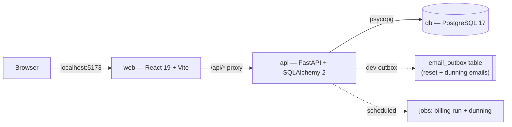
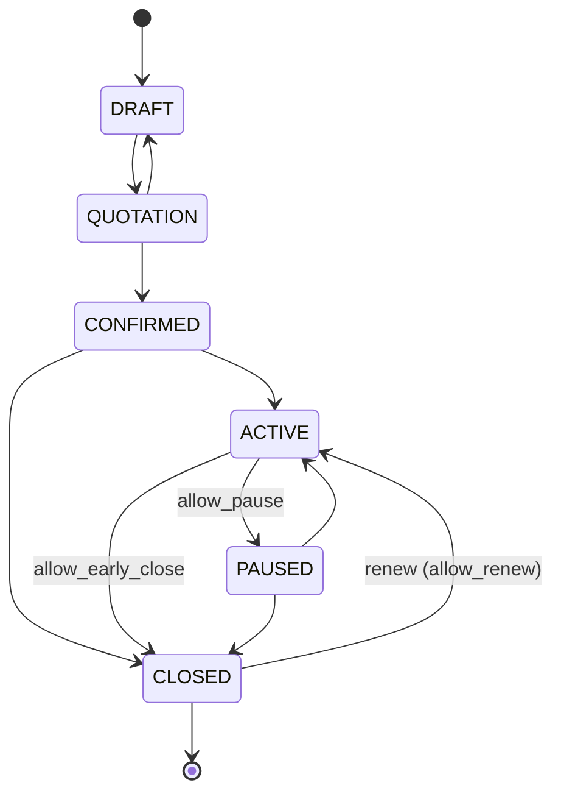
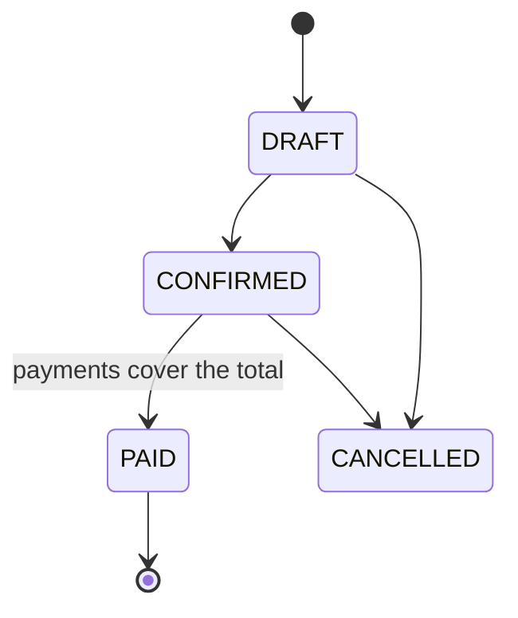
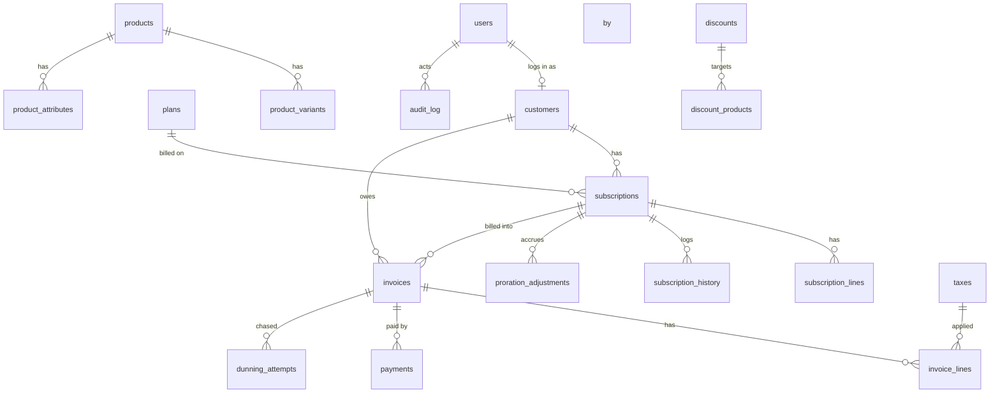

# Brightloop Subscriptions — Architecture

A single-origin web app (React) talking to a FastAPI backend over `/api`, backed by
PostgreSQL. Everything runs with one `docker compose up`.

## 1. Containers



## 2. Backend layering

Each domain is a vertical slice. Routers stay thin; business logic lives in services;
services flush, the route commits once.

```
app/
  api/<domain>/        FastAPI routers (auth, catalog, subscriptions, billing, payments, reporting)
  services/<domain>/   business logic (pricing, state machines, billing engine, dunning, MRR)
  models/<domain>/     SQLAlchemy models (one table per file, registered in the package __init__)
  schemas/<domain>/    Pydantic request/response models
  core/                settings, db session, security, RBAC, pagination, money, errors, audit, email
  jobs/                billing and dunning daily jobs
  tests/               pytest suite (126 tests)
```

Cross-cutting rules enforced everywhere: money is `Decimal`/`Numeric(12,2)` (string in JSON),
timestamps are UTC, every protected route depends on `require_role`, customer-scoped queries
are forced to the authenticated customer, and changes to prices/plans/discounts/record states
write an `audit_log` row.

## 3. Domains and ownership

| Domain | Backend | Frontend | Owner |
|---|---|---|---|
| Platform, auth, RBAC, audit log, email | `core`, `api/auth`, `models/auth` | `features/auth` | Member 1 |
| Catalog (products, variants, plans, taxes, discounts) | `api/catalog`, `models/catalog` | `features/catalog` | Member 2 |
| Subscriptions (quotations, lifecycle, proration) | `api/subscriptions`, `models/subscriptions` | `features/subscriptions` | Member 2 |
| Billing & invoices (engine, dry-run) | `api/billing`, `models/billing`, `jobs` | `features/invoices` | Member 3 |
| Payments, dunning, revenue-at-risk | `api/payments`, `models/payments` | `features/payments` | Member 3 |
| Reporting, MRR, customer portal | `api/reporting`, `services/reporting` | `pages`, `features/portal` | Member 4 |

## 4. Subscription state machine

One transition function rejects illegal moves and writes a `subscription_history` row plus an
audit entry. Pause / early-close / renew additionally honour the plan's flags.



## 5. Invoice state machine



Confirmed invoices are immutable; corrections go through cancel + re-issue.

## 6. Billing run (idempotent & transactional)

- Bills every `ACTIVE` subscription whose `next_billing_date <= as_of`.
- A unique constraint on `invoices(subscription_id, period_start, period_end)` means a re-run
  on the same day creates **zero** duplicates; a crash mid-run is safely resumable.
- `next_billing_date` is advanced in the **same transaction** as the invoice insert.
- A **dry-run preview** lists the invoices that would be created and an exceptions queue
  (missing tax, inactive customer, expired plan) before anyone commits.

## 7. Dunning & recovery

For each overdue invoice: reminder emails on **day 1, 3, 5, 7** after the due date (to the dev
outbox), then **automatic suspension** of the subscription after the final notice. Idempotent —
each reminder and the suspension are recorded once in `dunning_attempts`. The **revenue-at-risk**
panel ranks overdue subscriptions by amount and days late with a one-click reminder.

## 8. Data model (core tables)



Indexes that keep the dashboard under the 2-second budget:
`subscriptions(status, next_billing_date)`, `invoices(status, due_date)`, `invoices(customer_id)`,
`payments(invoice_id)`, and the unique `invoices(subscription_id, period_start, period_end)`.

## 9. MRR analytics (#3)

MRR per subscription = its line total normalised to a month by the plan's period. The dashboard
shows current MRR, ARR, ARPU and churn rate, plus a 6-month **New / Expansion / Contraction /
Churn** waterfall built from `subscription_history` (activations, closures) and
`proration_adjustments` (expansions, contractions).
