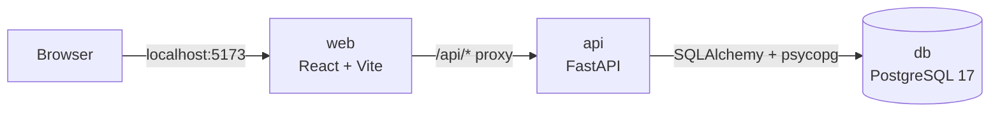

# Brightloop Subscriptions

> **How to run the app: see [HOW_TO_RUN.md](HOW_TO_RUN.md).** It covers starting, stopping, logs and resetting the database.
>
> Short version: open Docker Desktop, run `docker compose up --build` in the repo root, then go to http://localhost:5173. One command starts the frontend, the backend and the database together.

A subscription management system: product catalog and plans, quotations, the subscription lifecycle, recurring invoices, payments, dunning, a finance dashboard and a customer self-service portal.

**Status:** Phase 0 project skeleton. The team's split of the work is in [TEAM_TASK_DIVISION.md](TEAM_TASK_DIVISION.md).

## Demo credentials

The API creates these accounts automatically on startup if they don't exist. They're for local development and the demo only.

| Role | Email | Password |
|---|---|---|
| Admin | `admin@brightloop.dev` | `Admin@12345` |
| Staff | `staff@brightloop.dev` | `Staff@12345` |
| Customer | `customer@brightloop.dev` | `Customer@12345` |

To call protected endpoints from the API docs (http://localhost:8000/api/docs):
1. Use `POST /api/auth/login` with one of the accounts above.
2. Copy `access_token` from the response.
3. Click **Authorize** and paste the token. It's valid for 15 minutes.

## Architecture

- **web**: React 19, TypeScript, Tailwind CSS 4, TanStack Query and Table, Recharts. The Vite dev server proxies `/api` to the API, so the browser only ever talks to one origin.
- **api**: FastAPI with SQLAlchemy 2 and Alembic. When the container starts it applies pending migrations, creates the demo accounts if they're missing, then serves with auto-reload.
- **db**: PostgreSQL 17 with data in the `brightloop_db_data` Docker volume.

The full stack and coding conventions are in [.kiro/steering/tech.md](.kiro/steering/tech.md), and the folder layout and ownership are in [.kiro/steering/structure.md](.kiro/steering/structure.md).

## Everyday commands

Run these from the repo root while the application is running (see [HOW_TO_RUN.md](HOW_TO_RUN.md) to start it).

| Task | Command |
|---|---|
| Run backend tests | `docker compose exec api pytest` |
| Create a migration | `docker compose exec api alembic revision --autogenerate -m "<domain>: <change>"` |
| Apply migrations | Automatic when the API starts, or `docker compose exec api alembic upgrade head` |
| Seed demo data | `docker compose exec api python /scripts/seed.py` |
| Open a database shell | `docker compose exec db psql -U brightloop` |

## Working as a team

- **Your own database.** Each member runs their own Postgres container. The schema (Alembic migrations) and demo data (`scripts/seed.py`) are shared through git, so after `git pull` everyone gets the same tables and data.
- **Migrations.** Pull `main` right before you create one. The test suite fails if Alembic ends up with two heads, or if a model changed without a matching migration.
- **Config overrides.** Every setting has a default. To change one, such as a port, copy `.env.example` to `.env` and edit it.
- **Editor IntelliSense.** This is optional. Run `npm install` in `frontend/` on your machine. The container keeps its own `node_modules`, so the two don't interfere.
- **Commits.** Commit under your own Git identity (`git config user.name` and `git config user.email`). Push at least once an hour, and scope messages to your domain, for example `feat(catalog): add plan availability window`.

## Troubleshooting

| Problem | Fix |
|---|---|
| `port is already allocated` | Something else is using the port. Set `POSTGRES_HOST_PORT`, `API_PORT` or `WEB_PORT` in `.env`. |
| The API container stops with "Multiple head revisions" | Two migrations share a parent. Run `docker compose run --rm api alembic merge heads -m "merge heads"`, then commit the new migration. |
| `docker compose exec` says the service isn't running | Use `docker compose run --rm api <command>` instead. It starts a one-off container. |
| The database is in a bad state | Run `docker compose down -v`, then `docker compose up`. This erases your local data only ([what it deletes](HOW_TO_RUN.md#what-docker-compose-down--v-deletes)). |
| Edits don't show up | Check that you edited files under `backend/app` or `frontend/src`. Anything else needs `docker compose up --build`. |
